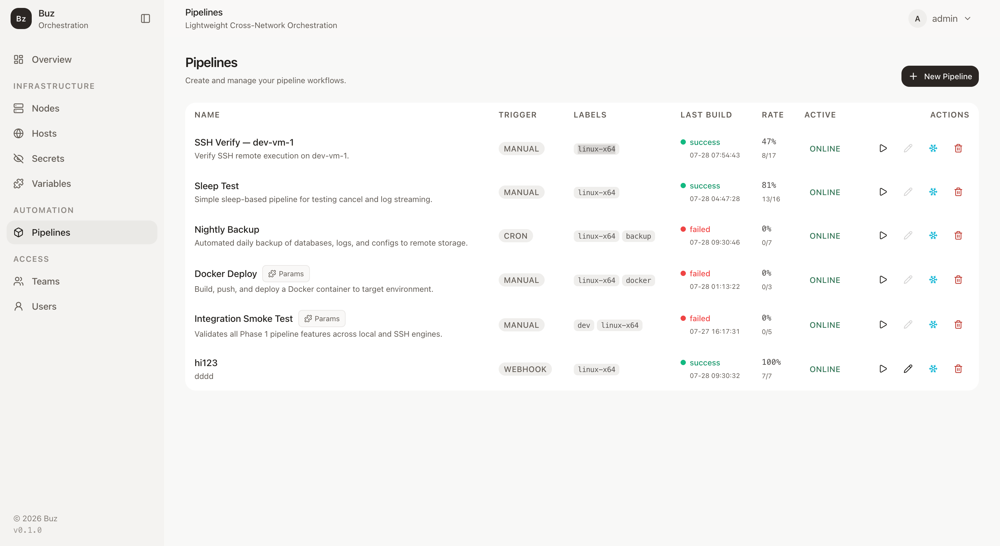
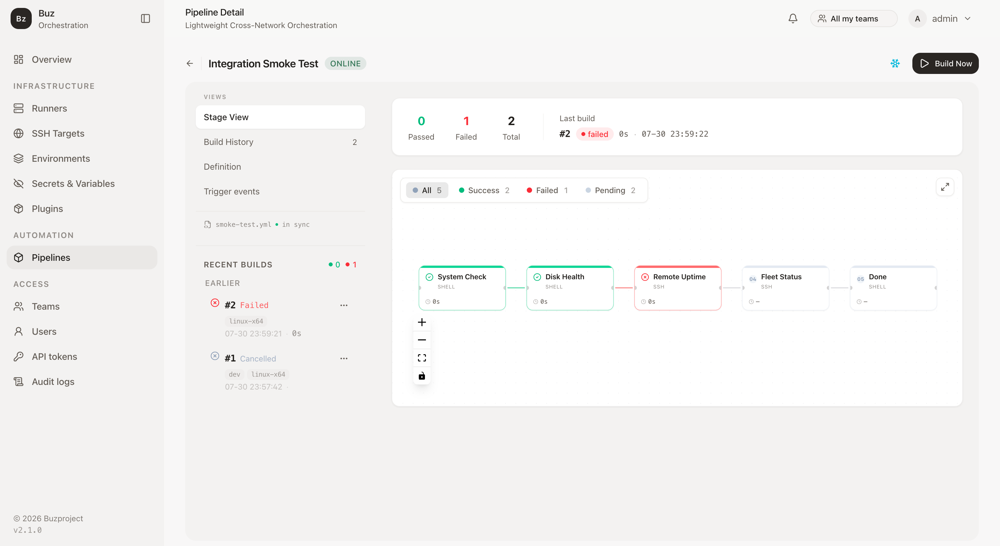

# Buz

Lightweight Cross-Network Orchestration Platform.

**Single Binary, Unified Orchestration, Zero Trust.**

Check the installed version any time: `buz-manager --version` / `buz-runner --version` — also shown in the Web UI (sidebar footer / login page) and via `GET /health`.

Tab completion for `buz-manager` / `buz-runner` / `buz-plugin`: `buz-manager completions <bash|zsh|fish|powershell|elvish>` (see [Shell Completions](docs/content/docs/03-operations/shell-completions.md)).



## Quick Start

```bash
# One-step: build dashboard + backend and start Manager
make run
# → http://localhost:8080  (first visit → /setup to create admin)

# Or step by step
make example        # create data/pipelines dirs (configs in example/conf/)
make build          # dashboard + release binaries (UI embedded in buz-manager)
cd example && BUZ_ALLOW_INSECURE_JWT=1 ../target/release/buz-manager

# Runner (register_token from Manager UI → Runners)
export BUZ_REGISTER_TOKEN="your-token"
./target/release/buz-runner -c example/conf/runner.toml

# Docs site (local)
make docs-serve
# → http://127.0.0.1:3001/  (or :1313 depending on Hugo)
```

**Lab / single-VM (arm64):** one-container image — see [Standalone](docs/content/docs/03-operations/standalone.md) (`buz-standalone`).

More: [docs Quick Start](docs/content/docs/00-quick-start/_index.md) · [Deployment](docs/content/docs/03-operations/deployment.md) · [Configuration](docs/content/docs/03-operations/configuration.md) (includes `[standalone]`).

## Architecture

Buz follows three core principles:

- **B (Binary)** — Standalone static binaries. No runtime dependencies.
- **U (Unified)** — Single Manager orchestrates runners across all network segments.
- **Z (Zero)** — Zero-trust security + zero operations burden.

Docs layout: **Quick Start → Architecture** (Authoring / Execution / Platform) → **Development** → **Operations**.



## Tech Stack

| Layer | Technology |
|-------|-----------|
| Backend | Rust, axum, tokio, sqlx, SQLite, russh |
| Frontend | Vue 3, TypeScript, TailwindCSS, shadcn/ui, Xterm.js |
| Docs | Hugo + Hextra theme |

## Project Structure

```
buz/
├── Cargo.toml                 # Workspace (shared / manager / runner / plugin-cli)
├── Makefile
├── crates/
│   ├── shared/                # Protocol, pipeline YAML schema, shared types
│   ├── manager/               # Control plane → buz-manager
│   ├── runner/                # Execution agent → buz-runner, buz-sandboxd
│   └── plugin-cli/            # Plugin authoring tool → buz-plugin
├── dashboard/                 # Vue 3 SPA (embedded into buz-manager at build)
├── docs/                      # Hugo + Hextra documentation site
├── example/                   # Local run scaffold
│   ├── conf/                  # manager.toml / runner.toml
│   └── pipelines/             # Sample pipeline YAML
├── deploy/                    # Packaged configs + ops scripts
│   ├── conf/                  # Docker / release config templates
│   ├── standalone/            # buz-standalone Compose
│   └── nginx/                 # Reverse-proxy examples
├── scripts/                   # Release packaging, e2e helpers, test.sh (feature-grouped test runner)
├── docker/
│   ├── Dockerfile             # buz-manager image
│   ├── Dockerfile.runner      # buz-runner image
│   ├── Dockerfile.standalone  # Manager + Runner (arm64 lab image)
│   ├── Dockerfile.sandboxd    # buz-sandboxd image (container / sandbox / vm isolation tiers)
│   ├── docker-compose.yml     # `make up` / `docker compose -f docker/docker-compose.yml up -d`
│   └── docker-compose.vm.yml  # sandbox (VM mode) compose overlay
└── .github/workflows/         # CI, Docker, release
```

## Security / 安全报告

**Please do not report security vulnerabilities through public GitHub issues.**

Use [Private vulnerability reporting](https://github.com/schiplat/buz/security/advisories/new) — reports stay private between you and the maintainers, with a first response targeted within **7 days**.

**请勿通过公开 issue 报告安全漏洞。** 请使用上方"私有漏洞报告"私下提交（7 天内首次响应）。社区插件的疑似恶意内容同样走 [buz-plugins 私有举报](https://github.com/schiplat/buz-plugins/security/advisories/new)。

### Security posture / 安全状态（2026-10-22）

| Scope | Status |
|-------|--------|
| Rust (`cargo audit`) | No known highs · 2 known mediums: RUSTSEC-2023-0071 (`rsa` Marvin Attack, via `russh`, no upstream fix — accepted & documented) |
| Frontend (`npm audit`, incl. `--omit=dev`) | 0 vulnerabilities |

Recent dependency-security fixes (rustls-webpki, follow-redirects, vite, Tailwind v4 chain) ship with the latest release — **deploy the newest tag**. The full policy, safe-harbor terms, and the complete known-limitations list (rate limiting, JWT secret handling, debug mode, CORS, WebSocket auth) live in [SECURITY.md](SECURITY.md).

依赖漏洞随每个版本发布修复，请部署最新 tag；完整安全策略、安全港条款与已知限制清单见 [SECURITY.md](SECURITY.md)。
