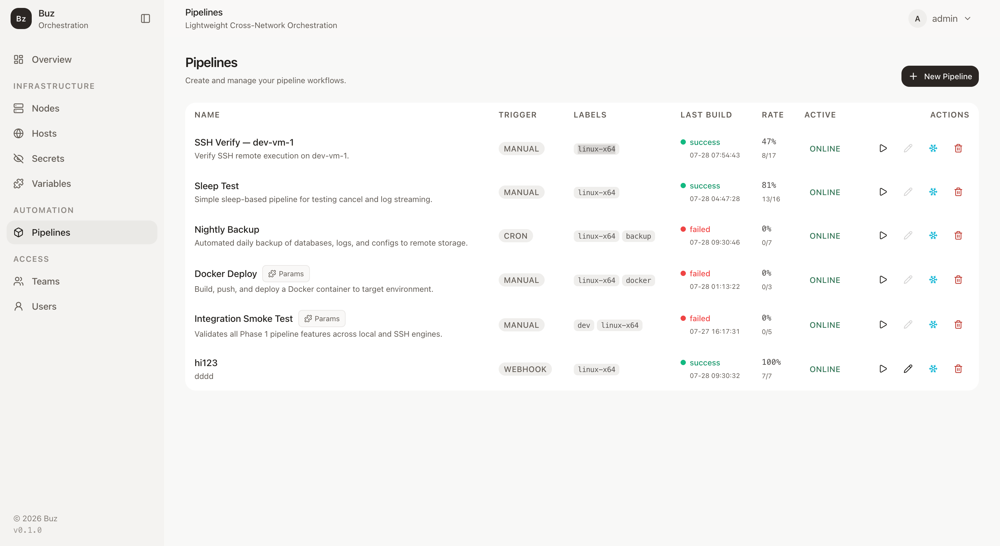
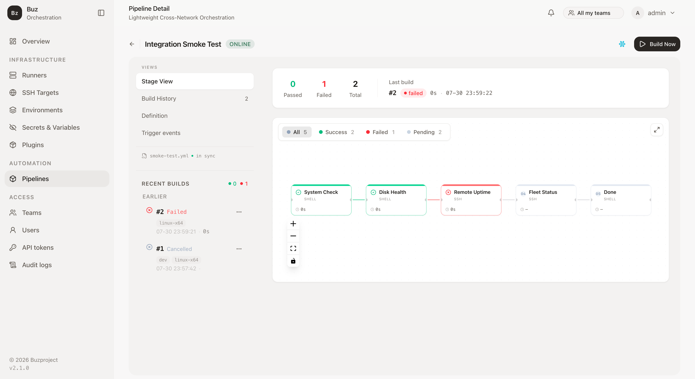

# Buz

**自托管流水线平台：每个角色一个静态 Rust 二进制，单容器 5 分钟跑通整套
Manager + Runner，一切皆 YAML 声明。**

[Buz 文档](https://buz.docs.sconts.com/) ·
[插件市场](https://plugins.buz.schiplat.com/) ·
[Releases](https://github.com/schiplat/buz/releases) ·
[安全政策](SECURITY.md)



[English](README.md) · 简体中文

## Buz 是什么

它为这样的环境而生：完整的 CI/CD 平台或 Kubernetes 太重，而你想要的只是
声明式管道、密钥管理和审计追踪——但机器异构，网络环境恶劣。

治理内建——带审批门的环境、RBAC、审计日志让生产部署始终有人把关；声明式
YAML、`uses:` 引用保存即锁定内容哈希、密钥永不自动注入，让 Buz 成为
AI agent 编写自动化的安全落点。详见[与 Drone、GitHub Actions、Jenkins
的完整对比](https://buz.docs.sconts.com/docs/01-architecture/comparison/)。

- **每个角色一个二进制。** `buz-manager`（控制平面）、`buz-runner`
  （执行代理）、`buz-sandboxd`（可选的主机监督器）。静态 Rust 二进制，
  无运行时依赖，无 agent 框架。
- **管道即 YAML。** 触发器（manual / webhook / cron）、带审批门的环境、
  并发队列、重试、每步超时——全部声明式，不需要在 UI 里配置。
- **步骤支持 shell、SSH、Docker 或插件。** `uses:` 引用在管道保存时
  对插件市场解析，并按内容哈希锁定版本。
- **密钥采用 GHA 风格。** 在使用处写 `${secrets.NAME}`，静态加密存储
  （AES-256-GCM），绝不自动注入进程环境。

在设计上，Buz 借鉴了 GitHub Actions 与 Jenkins 的优秀设计。

## 工作原理

Manager 是唯一监听端口的组件。Runner 分布在工作机器上，**出站**连接
Manager，通过长轮询 HTTP 认领任务——因此位于 NAT 后、不同云上或合作方
网络中的 Runner，无需任何入站端口、端口转发或 VPN。

部署目标由 Runner 通过 SSH（使用自己的凭证）触达，或作为容器直接运行在
Runner 所在主机上：

```text
┌──────────────────┐        outbound HTTPS/WS        ┌──────────────────┐
│      Manager     │ ◄────────────────────────────── │      Runner      │
│  控制平面         │   长轮询认领 / 日志推送          │  执行代理         │
│  仪表盘、API      │                                 │  shell/ssh/docker│
└──────────────────┘                                 └────────┬─────────┘
        │ 审计、RBAC、审批                                     │ ssh / docker
        ▼                                                      ▼
  ┌─────────────┐                                      ┌─────────────┐
  │   仪表盘     │                                      │  目标主机    │
  └─────────────┘                                      └─────────────┘
```



几个值得预先了解的设计选择：

- **解析即锁定。** `uses:` 插件引用在管道保存时对插件索引解析；解析出的
  版本和内容哈希会锁定进管道——上游模板变更无法影响已保存的管道。
- **环境是强制的。** 每条管道声明它可以部署的环境
  （`environments: [staging, prod]`）；每次运行都显式选择一个。可选的
  审批门可以为每个环境要求第二审批人。
- **隔离分级，且诚实。** 执行模式从 `host`（无沙箱）到 `container`、
  `sandbox`（gVisor）再到 `vm`（Firecracker 兼容）。Runner 上报宿主能
  提供的档位；档位由人选择；不可用的档位直接让任务失败，不会静默降级。
  Docker socket 访问等同主机 root——Buz 不会假装不是这样。完整信任模型
  见 [SECURITY.md](SECURITY.md)。
- **插件市场经过评审。** 官方 `buz/*` 模板有人工首评，此后 CI 按评审过的
  内容哈希跟踪每个版本。每个官方模板的出口流量面都有白名单。

完整的架构文档——管道编写、执行引擎、沙箱档位、RBAC、审计日志、环境——
见 [Buz 文档](https://buz.docs.sconts.com/)。

## 快速上手 — 5 分钟演示

一个容器在单台机器上运行整个栈（Manager + 同机 Runner）。全程复制粘贴，
不向任何仓库写入内容。

**要求**：Linux 或 Docker Desktop（macOS/Windows）、`docker` +
`docker compose`、`curl`、`openssl`。镜像为多架构
（`linux/amd64` + `linux/arm64`）——Intel 与 Apple Silicon Mac 均可直接运行。

```bash
# 1. 准备部署目录，拉取 compose 模板
mkdir -p /tmp/buz-demo && cd /tmp/buz-demo
curl -fsSLO https://raw.githubusercontent.com/schiplat/buz/master/deploy/standalone/docker-compose.yml

# 2. 演示密钥（现场生成，不会提交到任何地方）—— 然后启动
echo "BUZ_JWT_SECRET=$(openssl rand -hex 32)" > .env && chmod 600 .env
docker compose up -d
until curl -sf http://localhost:8080/health > /dev/null; do sleep 1; done
echo "Manager 已就绪"
```

然后在浏览器中：

1. 打开 **http://localhost:8080** —— 首次访问会引导你创建管理员账号
   （`/setup`）。
2. 镜像自带 `[standalone] auto_approve = ["standalone-runner"]`：内置
   Runner 会通过 loopback 自动注册，在 *Runners* 页显示 **online**——
   无需手工登记。
3. 在 UI 里创建一条管道（一个 `echo` shell 步骤），选择
   `standalone-runner` 标签并触发——看它被认领、执行、成功，Job 视图里
   有完整日志输出。
4. 可选：导入本仓库的
   [`example/pipelines/oss-config-demo.yml`](example/pipelines/oss-config-demo.yml)，
   端到端体验插件流程（`buz/config-fetch` 拉取配置包 + `buz/env-render`
   渲染 `.env`）。先在 *Secrets* 页录入模板引用的 secret 值。

这五分钟证明了：Manager/Runner 配对、仪表盘、job 调度与执行、插件市场、
密钥静态加密——单机即可验证生产部署的完整功能面。

> **此镜像仅用于评估。** 它启用了 `[standalone]` loopback 自注册，并把
> Manager 和 Runner 放在同一个容器里——适合实验环境，不是生产拓扑。
> 真实部署请使用分离的 `buz-manager` / `buz-runner` 包（[部署
> 指南](docs/content/docs/03-operations/deployment.md)）。

清理：`docker compose down`，然后删除演示目录即可。

## 开发

在本仓库工作需要 Rust 工具链（通过 `rust-toolchain.toml` 钉定为
**1.99.1**，rustup 会自动使用）、构建 dashboard 的 Node.js、GNU `make`，
以及可选的 Docker（容器测试）。

```bash
# 全量构建（dashboard 在编译期嵌入 buz-manager）
make build

# 使用 example 脚手架运行本地实例
make run          # → http://localhost:8080（首次访问 → /setup）

# 迭代时的快速路径（debug 构建）
make dev
```

### 测试

`scripts/test.sh` 按功能分组运行测试目标，避免每次迭代都付出整个
workspace 的代价：

```bash
scripts/test.sh list           # 显示分组（runner、sandbox、pipeline、auth、plugins 等）
scripts/test.sh sandbox        # 运行单个分组
scripts/test.sh '^slot_scheduling_test$'   # 对测试目标做正则匹配
scripts/test.sh all            # CI 等效：fmt + clippy + cargo test --all + dashboard
```

`all` 与 [.github/workflows/ci.yml](.github/workflows/ci.yml) 完全一致——
推送前请先运行。其余用法只是开发捷径。

### 仓库结构

```text
buz/
├── Cargo.toml                 # workspace：shared / manager / runner / plugin-cli
├── crates/
│   ├── shared/                # 协议、管道 YAML schema、加密、共享类型
│   ├── manager/               # 控制平面 → buz-manager
│   ├── runner/                # 执行代理 → buz-runner、buz-sandboxd
│   └── plugin-cli/            # 插件编写工具 → buz-plugin
├── dashboard/                 # Vue 3 SPA（编译期嵌入 buz-manager）
├── docs/                      # Hugo + Hextra 文档站
├── example/                   # 本地运行脚手架（conf/、pipelines/、data/）
├── deploy/                    # 发布配置模板、standalone compose、nginx 样例
├── scripts/                   # 发布打包、测试运行器、运维辅助脚本
├── docker/                    # Dockerfile + compose overlay（含多架构 standalone）
└── .github/workflows/         # CI、release、Docker 镜像发布
```

### 技术栈

| 层 | 技术 |
|----|------------|
| 后端 | Rust、axum、tokio、sqlx、SQLite、russh |
| 前端 | Vue 3、TypeScript、TailwindCSS、shadcn/ui、Xterm.js |
| 文档 | Hugo + Hextra 主题 |

### 贡献

- 从 `master` 拉分支，向 `master` 提 PR。
- 推送前：`cargo fmt --all -- --check`、`cargo clippy --workspace
  --all-targets -- -D warnings`、`cargo test --all`，以及 dashboard 的
  `npm test` + `npm run build`——与 CI 相同的集合。`scripts/test.sh all`
  是一键版本。
- 纯文档提交通过 `paths-ignore` 跳过 Rust CI，由文档部署工作流处理。
- 插件 PR 在 [schiplat/buz-plugins](https://github.com/schiplat/buz-plugins)——
  每个官方模板都需要人工首评后才会进入 ci-tracking。

## 安全

**请勿通过公开 GitHub issue 报告漏洞。** 请使用
[私有漏洞报告](https://github.com/schiplat/buz/security/advisories/new)——
报告仅在维护者与报告者之间保密，首次响应目标 7 天，善意研究受安全港条款
保护。疑似恶意**步骤模板**同样通过
[buz-plugins](https://github.com/schiplat/buz-plugins/security/advisories/new)
私下报告。

完整政策——信任模型、已知限制（无限流、JWT secret 即根密钥、Runner 租户
边界、执行档位的诚实说明等）、依赖通告策略，以及受支持的密钥轮换流程
（`buz-manager rotate-jwt-key`）——见
[SECURITY.md](SECURITY.md)。

评估者在对外暴露任何东西之前应该知道的两点：

- standalone 演示镜像启用了 loopback 自注册，且 Manager 和 Runner 同箱
  运行——它是实验工具，不要暴露到公网。
- Runner 以 Runner 的 OS 用户身份执行不可信的管道代码；同一 Runner 上的
  job 之间**没有**相互隔离。请按信任边界使用独立的 Runner 主机。

## 许可证

[Apache-2.0](LICENSE)
