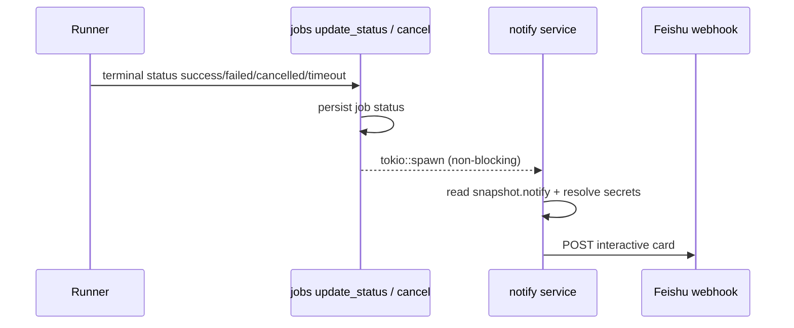

When a job reaches a **terminal** status, Manager can push a notification to external chat bots. Configuration is **YAML-only** (`notify:`); webhook URLs live in Infrastructure **Secrets**. Sending is asynchronous and never blocks the job state machine.

> **First channel:** Feishu (Lark) custom robot (`type: feishu`). The channel interface is generic — DingTalk / Slack / email are not implemented yet.

Related: [Pipeline Format → `notify`](./pipeline-format.md#notify) · [Secrets & Variables](./secrets-variables.md) · [YAML-First Authoring](./yaml-first-authoring.md)

---

## Quick start

1. Create a Feishu **custom bot** in a group → copy the webhook URL.
2. In Buz → Infrastructure → Secrets, create a same-team secret (e.g. `FEISHU_WEBHOOK`) whose value is that URL.
3. Set Manager `server.public_base_url` to the public UI origin (so the card can link to Job Detail).
4. Add `notify:` to the pipeline YAML and save / sync.

```yaml
notify:
  - type: feishu
    webhook: ${secrets.FEISHU_WEBHOOK}
    # on: [success, failure]           # default
    # on: [success, failure, cancelled]
```

5. Run the pipeline. On success/failure you should see an interactive card in the Feishu group.

---

## YAML configuration

### Schema

```yaml
notify:
  - type: feishu                          # required — channel kind (whitelist)
    webhook: ${secrets.FEISHU_WEBHOOK}    # required — secret reference
    on: [success, failure]                # optional — see Events below
```

| Field | Required | Description |
|-------|----------|-------------|
| `type` | Yes | Channel implementation. Currently only `feishu`. Unknown values **fail Validate**. |
| `webhook` | Yes | Must be `${secrets.NAME}` or a bare secret name (purpose-slot style). Plain HTTPS URLs are **rejected** at Validate — store the URL in Secrets. |
| `on` | No | Which terminal events trigger this channel. See below. |

- Registered on `NotifyChannelYaml` with `deny_unknown_fields` — typos like `webhok:` fail Validate.
- Multiple channels in the list are supported (each evaluated independently). Today only `feishu` is implemented; unknown types at **send** time are skipped with a warning (Validate already blocks unknown types for new YAML).

### Events (`on`)

| YAML value | Matches job status | Default included? |
|------------|--------------------|-------------------|
| `success` | `success` | Yes |
| `failure` | `failed`, `timeout` | Yes |
| `cancelled` | `cancelled` | **No** |

**Default when `on` is omitted:** `[success, failure]`.

**Why exclude cancelled by default?** Accidental UI cancels would spam the chat group. Add `cancelled` explicitly when you want cancel alerts:

```yaml
on: [success, failure, cancelled]
```

**Empty list:** `on: []` never sends for that channel.

### Secrets & team scope

- `webhook: ${secrets.FEISHU_WEBHOOK}` is collected into **effective secrets** (same as `env:`).
- Validate / Save require the secret to exist in the **same team** as the pipeline (unless `team_shared`).
- At send time Manager decrypts the secret and POSTs to the webhook. The plaintext URL is **never** written into the job snapshot — only the `${secrets.…}` expression is frozen at trigger.

---

## Manager config: Job Detail deep link

Cards include a **View Job** button when `server.public_base_url` is set.

```toml
# conf/manager.toml
[server]
host = "0.0.0.0"
port = 8080
# Public UI origin as browsers reach it (scheme + host [+ port], no path).
# Trailing slash is optional — Manager trims it.
public_base_url = "https://buz.example.com"
```

Environment override (config crate prefix):

```bash
export BUZ__SERVER__PUBLIC_BASE_URL="https://buz.example.com"
```

| Setting | Effect |
|---------|--------|
| Non-empty `public_base_url` | Card gets button → `{public_base_url}/jobs/{job_id}` |
| Empty / omitted | Card fields only; **no** View Job button |

URL shape matches the Vue route `/jobs/:id` (Job Detail). Users must still be logged in to open the page (normal UI auth).

> Behind a reverse proxy, use the **external** HTTPS origin users type in the browser — not `http://127.0.0.1:8080` unless that is what clients use.

---

## When notifications fire



| Trigger path | Job status written | Notify? |
|--------------|--------------------|---------|
| Runner `PATCH` job status (no `step_order`) | `success` / `failed` / `cancelled` / `timeout` | Yes, if channel `on` matches |
| UI **Cancel** | `cancelled` | Yes, only if `cancelled` ∈ `on` |
| Per-step status updates (`step_order` set) | (job status unchanged) | No |
| Already terminal (early return) | ignored | No (dedupe) |

**Dedup:** Manager refuses to overwrite an already-terminal job status. Notify runs only on the transition **non-terminal → terminal**, so each job sends at most once per channel match.

**Async:** `tokio::spawn` — Feishu latency does not delay Runner heartbeats or the cancel HTTP response.

**Failure policy:** HTTP / decrypt / missing-secret errors are **logged** (`warn`). They do **not** roll back job status and are not surfaced in the Job UI today.

---

## Snapshot freeze

At **trigger** (`do_trigger`), Manager loads `notify:` from the on-disk YAML (file-backed pipelines) and stores it on the job snapshot JSON:

```json
{
  "notify": [
    {
      "type": "feishu",
      "webhook": "${secrets.FEISHU_WEBHOOK}",
      "on": ["success", "failure"]
    }
  ],
  "tasks": [ ... ],
  "triggered_by": "..."
}
```

- Historical jobs keep the notify config from trigger time (pipeline edits later do not change in-flight/past cards’ channel list).
- Non-YAML / form pipelines without file `notify:` get `notify: null` / absent → no send.

---

## Feishu card content

Interactive card (`msg_type: interactive`):

### Header

| Job status | Title | Color template |
|------------|-------|----------------|
| `success` | Pipeline succeeded | green |
| `failed` / `timeout` | Pipeline failed | red |
| `cancelled` | Pipeline cancelled | orange |

### Body fields

| Field | Source |
|-------|--------|
| **Pipeline** | Pipeline display name |
| **Status** | Terminal status string (`success` / `failed` / `cancelled` / `timeout`) |
| **Job** | Job id (UUID) |
| **Duration** | `end_time − start_time` (e.g. `2m 5s`); `—` if timestamps missing |
| **Triggered by** | `trigger_by` (`username` / `cron` / `webhook` / `git` / …) |

### Action

| Condition | UI |
|-----------|-----|
| `public_base_url` set | Primary button **View Job** → `{base}/jobs/{job_id}` |
| otherwise | No button |

Webhook URL is used only in memory for the POST; it is not shown on the card.

---

## Feishu bot setup (ops)

1. Open the Feishu group → **Settings** → **Bots** → **Add custom bot** (wording varies by Feishu/Lark edition).
2. Copy the webhook (`https://open.feishu.cn/open-apis/bot/v2/hook/...` or regional equivalent).
3. Store it as a Buz Secret (kind optional; value = full webhook URL, including any signed query if the bot requires it).
4. Restrict bot permissions / group membership as your security policy requires — anyone with the Secret value can post to that group.

**Tip:** Prefer a dedicated group (or topic) for CI alerts so cancel/success noise stays out of human chat.

---

## Definition & authoring UI

| Surface | Behavior |
|---------|----------|
| **Quick YAML Reference** | Commented `notify:` sample |
| **Pipeline Definition** | Dedicated **Notify** section (type / webhook expression / `on`; or “not configured”) |
| **Form authoring** | Not available — YAML only |

---

## Limits (current)

| Topic | Status |
|-------|--------|
| Feishu custom bot | ✅ |
| DingTalk / Slack / email | ❌ |
| Notify UI / DB table | ❌ (YAML only) |
| Job Detail deep link | ✅ via `server.public_base_url` |
| Pipeline Detail deep link | ❌ |
| Retry / dead-letter for failed sends | ❌ (log only) |
| Runner-side send | ❌ (secrets stay on Manager) |

---

## Troubleshooting

| Symptom | Check |
|---------|--------|
| No message at all | Job terminal? `on` includes the event? Snapshot has `notify`? Secret exists same team? |
| Cancel silent | Default `on` omits `cancelled` — add it explicitly |
| Validate fails on `webhook` | Must be `${secrets.NAME}`, not a raw `https://…` URL |
| Validate fails unknown type | Only `feishu` today |
| Card without View Job | Set `server.public_base_url` and restart Manager |
| View Job 404 / wrong host | Base URL must match how users open the UI (proxy hostname, HTTPS) |
| Feishu `code != 0` in Manager logs | Bot revoked, webhook rotated, or Feishu rate limit — rotate Secret / check bot settings |

Manager log keywords: `job notify`, `notify channel send failed`, `notify webhook secret`.

---

## Code map

| Piece | Path |
|-------|------|
| YAML schema + validation | `crates/shared/src/pipeline_yaml.rs` (`NotifyChannelYaml`) |
| Notify dispatch + secret resolve | `crates/manager/src/services/notify/` |
| Feishu card builder | `crates/manager/src/services/notify/feishu.rs` |
| Terminal hooks | `crates/manager/src/api/jobs.rs` (`update_status`, `cancel`) |
| Snapshot freeze | `crates/manager/src/api/pipelines.rs` (`do_trigger`) |
| Public base URL | `server.public_base_url` in Manager config |
| Example (commented) | `example/pipelines/notify-feishu-demo.yml` |
