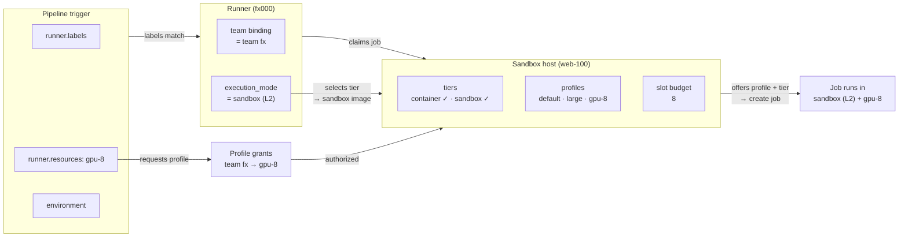

> **Status: SHIPPED (2026-10-29).** This page is the implementation contract and now describes
> shipped behavior. See [Configuration](/docs/03-operations/configuration/) → "Sandbox host
> configuration" for the operator workflow and the migration steps from the retired
> `conf/sandboxd.toml`. Legacy `runner.toml → [sandbox]` tier keys are ignored on load.

This page records the accepted design for moving sandbox host policy out of host-local files into
**Manager-managed configuration**, adding **named resource profiles**, and making sandboxed job sizing
**authorizable and quota-aware**. It also defines the instance identities used to correlate Manager,
Runner, sandboxd, and hosts end to end.

## Decision summary

- **Manager is the single source of truth** for sandbox host policy. `sandboxd.toml` is retired;
  only host bootstrap facts remain local (env/CLI).
- **sandboxd pulls its configuration** from Manager over HTTPS using a per-instance token, with a
  long-poll for near-real-time changes and periodic polling as fallback. No configuration signing
  key is introduced.
- **Named profiles** (`memory`, `cpu`, `pids`, `slots`) replace the fixed `memory_limit`/`cpu_limit`
  pair. `default` is reserved and implicitly available to every team.
- **The profile catalog is fleet-wide** (Platform defaults); a host document is a selection that
  inherits it wholesale and opts entries out via `exclude_profiles`. A profile name means the same
  envelope on every host.
- **Jobs request a profile by name** through `runner.resources`; Manager checks a **team grant** at
  trigger and claim time. Numeric overrides from pipelines are never accepted.
- **Two capacity limits**: `max_concurrent_jobs` per Runner (process concurrency) and
  `max_resource_slots` per sandbox host (physical capacity). Both gates must pass.
- **Claim strategy is configurable** (`backfill` or `fifo`) per Runner and hot-reloads on heartbeat.
- **Runner keeps an observational `sandboxd.snapshot.json`**; sandboxd keeps its own root-owned
  configuration cache for recovery.
- **Identity is env-first and propagated end to end**: `manager_instance_id`, `host_id`,
  `runner_instance_id`, `runner_id`, `sandboxd_instance_id`.
- **Manager remains single-instance** (SQLite). `manager_instance_id` is an identity and ownership
  binding, not an HA mechanism.

## Why

Before this change the host supervisor was configured by `deploy/conf/sandboxd.toml`, while the
Runner's `runner.toml → [sandbox]` repeated the same tier images and runtimes. The two files must be kept in
sync by hand, and the resource envelope is a fixed default (`memory_limit = "2g"`,
`cpu_limit = "2"`, `--pids-limit 256` hardcoded). There is no per-job sizing, no Manager-side
visibility, and no way to authorize "large" jobs separately from ordinary ones.

The design turns a host-local policy file into a first-class Manager resource: ops edit it in one
place, jobs request from a finite menu, and the Manager can answer "who is allowed to consume the
large envelopes, and is the host currently enforcing the version we think it is?".

## Terminology

| Term | Meaning |
|------|---------|
| **Manager** | Control plane: API, UI, database, authorization, scheduling. |
| **Runner** | Agent that registers with Manager, claims jobs, prepares workspaces, and drives steps. Holds no Docker socket. |
| **sandboxd** | Host-side privileged supervisor (`buz-sandboxd`). Creates/starts/execs/destroys job containers or VMs through the Docker CLI and enforces the host policy. |
| **Host** | One physical or virtual machine. May run one or more Runners and one or more sandboxd instances. |
| **Tier** | Isolation boundary: `host`, `container`, `sandbox`, `vm`. See [Sandbox Isolation Tiers](/docs/01-architecture/execution/sandbox-isolation-tiers/). |
| **Profile** | Named resource envelope: memory, CPU, pids, and scheduling weight. Orthogonal to tier. |

### How tiers, profiles, and host offers interact

Three independent dimensions determine what a job gets when it runs on a
sandboxed host. Each is controlled at a different level and none can replace
the others:

```
Pipeline trigger
    │
    ├── Tier          Runner.execution_mode selects the isolation boundary
    │                 (container / sandbox / vm) — constrained by what the
    │                 Runner's capability probe reports as supported.
    │
    ├── Profile       Pipeline `runner.resources: <name>` selects the resource
    │                 envelope (memory / cpu / pids / slot weight) — authorized
    │                 via team-level profile grants.
    │
    └── Host offers   The sandbox host's config document declares which tier
                      images and profiles this machine provides. Dispatch
                      checks the host actually offers the requested profile.
```

- **Tier answers "how isolated from the host kernel?"** — a security choice
  (`container` shares the kernel; `sandbox` uses gVisor; `vm` uses a real
  guest kernel). Selected per Runner, constrained by probe results.
- **Profile answers "how much resource does the job get?"** — a capacity
  choice (memory, CPU, pids). Requested per pipeline, authorized per team.
- **Host offers answer "can this machine serve the combination?"** — the host
  offers the whole platform catalog unless its document excludes entries it
  cannot serve (`exclude_profiles`), and pins whatever tier images it does not
  inherit. A job whose tier or profile is missing on the selected host fails
  closed.



The three are orthogonal: a `sandbox` tier job can use the `default` profile,
and a `container` tier job can use `gpu-8`. Neither dimension subsumes the
other.

The authoring side of this split — what pipeline authors write versus what
platform admins configure, and why Runner labels use capability vocabulary
rather than tier names — is described in
[Runner Policy — Who decides what: the authoring boundary](/docs/01-architecture/execution/runner-policy/#who-decides-what-the-authoring-boundary).

## Identity model

Every process and the host itself have a stable identity. IDs are public identifiers, never
credentials; authorization still comes from tokens.

| Identity | Owner | Environment variable | Default / persistence | Uniqueness |
|----------|-------|----------------------|-----------------------|------------|
| Manager instance | Manager process/deployment | `BUZ_MANAGER_INSTANCE_ID` | Generated on first boot and persisted in the Manager DB | Unique per logical control plane |
| Host | One machine | `BUZ_HOST_ID` | `/etc/machine-id`, else hostname (warn) | Unique across machines; shared by all processes on the host |
| Runner instance | Runner deployment | `BUZ_RUNNER_INSTANCE_ID` | Generated on first boot, persisted under the Runner state directory | Unique per Manager |
| Runner auth ID | Manager runner record | `BUZ_RUNNER_ID` (optional pre-provisioning) | Manager-issued UUID at registration | Globally unique |
| sandboxd instance | sandboxd process | `BUZ_SANDBOXD_INSTANCE_ID` | `sandboxd-<host_id>` for a single instance; explicit when multiple share a daemon | Unique per Docker daemon |

```
manager_instance_id
└── host_id                         one machine
    ├── runner_instance_id ──► runner_id      Manager-issued auth identity
    └── sandboxd_instance_id                  one per sandboxd instance
```

Notes:

- **Runner has two IDs on purpose.** `runner_id` is the Manager-issued identity used in the token
  `sub` and foreign keys. `runner_instance_id` is the deployment identity read from the environment
  and survives re-registration, so UI and logs can correlate the same installation. Pre-provisioning
  is supported: a deployment may set `BUZ_RUNNER_ID` to pin registration to a specific runner row —
  a mismatch (config drift) rejects the registration instead of silently binding to another row.
  The pin is correlation data, never an auth input.
- **Host ID must be assigned explicitly in containers and VM templates.** Cloned VMs often share
  `/etc/machine-id`; set `BUZ_HOST_ID` in the compose file or VM template instead of relying on the
  fallback.
- **IDs persist.** A generated ID is written once and reused across restarts. Changing an ID changes
  the identity: sandboxd needs re-enrollment, and a Runner instance appears as a new deployment.
- **Validation.** `[A-Za-z0-9][A-Za-z0-9._-]{0,63}`, case-sensitive. IDs appear in URL paths, so
  whitespace, control characters, and path separators are rejected.
- **No reuse of the existing `hosts` table.** That table stores SSH deployment targets; execution
  hosts use the `host_id` field on runners and sandbox hosts.

### Propagation

| Path | IDs carried |
|------|-------------|
| Manager → dashboard | `manager_instance_id` in `GET /api/v1/meta` and response headers; `host_id`, `runner_id`, `runner_instance_id`, `sandboxd_instance_id` in runner, sandbox-host, job, and audit DTOs — including the OpenAPI schema and dashboard types. |
| Dashboard → Manager | Ops routes use `(host_id, sandboxd_instance_id)` in the path; list filters accept `host_id`, `runner_id`, `sandbox_instance_id`. The browser is stateless and never generates IDs. |
| Runner → Manager | Registration carries `host_id` and `runner_instance_id` (plus an optional requested `runner_id`); heartbeat carries `host_id`, `runner_instance_id`, `sandboxd_instance_id`, and the sandbox status block. |
| Manager → Runner | Heartbeat responses carry `manager_instance_id`; the Runner records which control plane it is talking to. |
| sandboxd → Manager | Config fetch carries `applied_version`; the token resolves `(host_id, sandboxd_instance_id)`. The response repeats `manager_instance_id`, `host_id`, and `sandboxd_instance_id`. |
| Runner ↔ sandboxd | `Status` and probe responses carry `host_id`, `sandboxd_instance_id`, and the applied config version/hash. |
| Jobs, audit, logs | Job rows persist `host_id`, `runner_id`, `runner_instance_id`, `sandboxd_instance_id`, `resource_profile`, and the dispatching `manager_instance_id`; audit records and tracing spans carry the same fields. |

## Topology and configuration key

The configuration resource is keyed by **`(host_id, sandboxd_instance_id)`**, never by `runner_id`
or hostname alone. That matches sandboxd's own identity and the container label used for stale
cleanup (`buz.sandboxd.instance=<id>`), and it keeps multiple Runners or multiple sandboxd instances
from sharing an ambiguous configuration.

| Topology | Supported | Notes |
|----------|-----------|-------|
| 1 Runner ↔ 1 sandboxd ↔ 1 Docker daemon | Yes | Typical deployment. |
| N Runners → 1 sandboxd | Yes | All Runners must use the same allowed UID/GID and the same workspace volume/root. They share one configuration and one physical capacity pool. |
| 1 Docker daemon ← N sandboxd | Yes | Each instance has its own socket, workspace root/volume, and `instance_id`. They share the daemon's physical capacity; ops must partition the slot budgets. |
| 1 Runner → N sandboxd | No | The Runner has a single `supervisor_socket`. A mode→socket map would be a separate feature. |
| 1 sandboxd → N Docker daemons | No | `docker_cli`/`DOCKER_HOST` points at one daemon. |

Capacity is split into two different limits:

- `max_concurrent_jobs` — per **Runner**: how many job processes this Runner will babysit. This is
  the existing UI-managed field.
- `max_resource_slots` — per **sandbox host**: how much of the physical envelope the host hands out
  at once. A `large` job with `slots = 4` consumes four units.

Example: a host with `max_resource_slots = 8`, a Runner with `max_concurrent_jobs = 4`, and profiles
`standard = 1 slot`, `large = 4 slots`:

| Concurrent jobs | Job-count gate | Slot gate | Result |
|-----------------|----------------|-----------|--------|
| 4 × standard | 4/4 | 4/8 | Pass |
| 2 × large | 2/4 | 8/8 | Pass |
| 3 × large | 3/4 | 12/8 | Blocked by slots |
| 1 × large + 4 × standard | 5/4 | 8/8 | Blocked by job count |

If one Docker daemon hosts multiple sandboxd instances, the Manager can display the sum of their
budgets but cannot know the daemon's real capacity. Ops must keep the sum within the machine.

## Resource profiles

A profile is a named, finite envelope. It contains resources only — never an image, runtime, tier,
network, or mount. Those belong to the tier/host configuration.

```toml
[profiles.default]
memory = "2g"
cpu = "2"
pids = 256
slots = 1

[profiles.large]
memory = "8g"
cpu = "4"
pids = 512
slots = 4
```

**The catalog lives in one place: Platform defaults.** Profile names and numbers are defined
fleet-wide (Manager `sandbox_default_profiles`, edited from the Sandbox hosts page). A name means
the same thing on every host — a pipeline asking for `large` gets the same envelope regardless of
which machine picks up the job. Host documents do not restate the catalog and there is no
per-host profile creation.

- `default` is reserved: only the catalog defines its values, and no other profile may use the
  name. It is the **fallback envelope** — every job without `runner.resources` runs in it — and it
  is implicitly available to every team (never grant-gated). A `default` profile with `slots > 1`
  warns: every job that omits `resources` consumes that baseline. Before an operator saves a
  catalog, a built-in floor ships a standard ladder sized for common CI workloads — `small`
  (`2g` / 2 cpu / 256 pids / 1 slot), `medium` (`4g` / 4 / 512 / 2), `large` (`8g` / 8 / 1024 / 4),
  each dimension doubling — with `default` seeded as an **alias of `small`**: jobs without
  `runner.resources` run in the small envelope. The floor applies only until an operator saves
  their own catalog; there `default` and `small` are mandatory (`small` cannot be removed or
  renamed — it carries the `default` alias, and catalogs saved before it was mandatory gain it
  automatically on load), while the remaining entries can be renumbered, renamed, added, or
  deleted.
- **A host selects from the catalog; it does not define into it.** Every catalog profile is
  offered on a host unless the host's document names it in `exclude_profiles` — the machine-level
  opt-out for envelopes the machine cannot serve (a small VM excluding `gpu-8`). Excluding
  `default` is rejected: the fallback must exist everywhere. Legacy host-side overrides keep
  working but lose their UI entry; the catalog is the single vocabulary.
- `slots` is a scheduling weight, not a cgroup setting. It is resolved from the **applied** host
  configuration when a job is claimed.
- `pids` replaces the currently hardcoded `--pids-limit 256`. The `/tmp` tmpfs size (currently
  128 MiB) remains fixed for now; it is not part of a profile.
- Profile names are validated (`[a-z0-9][a-z0-9-]{0,31}`); the `default` name is reserved.
- Existing `memory_limit`/`cpu_limit` semantics become the implicit `default` profile.

Profiles and tiers are orthogonal: `sandbox` selects the isolation boundary, `large` selects the
size. A job can run `large` on `container`, `sandbox`, or `vm`. See
[How tiers, profiles, and host offers interact](#how-tiers-profiles-and-host-offers-interact) for
the full three-dimension model.

## Managed configuration document

Manager stores one desired document per `(host_id, sandboxd_instance_id)`. The document is a
**selection, not a restatement**: tiers, profiles, and network inherit the platform catalog unless
the host pins its own value, and `exclude_profiles` opts catalog entries out on this machine:

```json
{
  "manager_instance_id": "mgr-01",
  "host_id": "host-a",
  "sandboxd_instance_id": "sandboxd-01",
  "version": 12,
  "profiles": {},
  "exclude_profiles": ["gpu-8"],
  "tiers": {
    "sandbox": { "image": "repo@sha256:…", "runtime": "runsc" }
  },
  "network": ""
}
```

sandboxd is always served the **effective** document — the platform catalog merged under the
host's own definitions, minus its exclusions, with the `bridge` network floor applied — and
validates exactly those bytes. What the host declares above reads: offer the whole catalog except
`gpu-8`, pin the `sandbox` tier image/runtime, inherit everything else.

This removes the duplicated tier image/runtime configuration from
`runner.toml → [sandbox]`. The Runner no longer needs to know images at all:

- `CreateJob` sends `mode`, `profile` name, and `workspace`; sandboxd resolves image, runtime, and
  limits from its applied document.
- `ProbeCapabilities` probes the tiers in sandboxd's own applied document instead of accepting a
  backend list from the Runner.
- The "both halves must agree on the image digest" check disappears structurally.

`runner.toml → [sandbox]` then keeps only host-local wiring: `supervisor_socket`,
`workspace_root`, `request_timeout_seconds`, and `snapshot_path`.

Validation happens in two places: Manager on write (names, numeric syntax, digest-pinned images,
`default` present, `slots` in the `1..=32` range used by `max_concurrent_jobs`, network non-empty),
and sandboxd again on apply. A document is applied atomically or not at all.

## Delivery: sandboxd pulls, Manager wakes it

### Why pull, and why no signing key

The existing Runner↔Manager channel is HTTPS plus a Runner JWT. It is encrypted and authenticated
**between those two processes**, but its endpoint is the Runner, not sandboxd. Relaying a policy
document through the Runner would terminate transport integrity at the Runner, which executes
untrusted job code. Application-level signing would close that gap but adds a key pair, distribution,
rotation, and replay handling.

Instead, sandboxd is a first-class Manager client:

- HTTP(S) to Manager, authenticated with a per-instance opaque token (stored hashed by Manager).
- The token is scoped to `(manager_instance_id, host_id, sandboxd_instance_id)` and can only read its
  own configuration and report status.
- TLS provides confidentiality and integrity. Production deployments must use HTTPS; host-local
  Compose networks may use HTTP only for local development.
- No new network listener is added to sandboxd; the Unix socket remains its only inbound interface.

### Bootstrap (the only remaining local configuration)

| Setting | Source | Notes |
|---------|--------|-------|
| `instance_id` | `BUZ_SANDBOXD_INSTANCE_ID` | Required when multiple instances share a Docker daemon. |
| `host_id` | `BUZ_HOST_ID` | Must match the host's Manager record. |
| Manager URL | `BUZ_MANAGER_URL` | Base URL of the owning Manager. |
| Expected Manager instance | `BUZ_MANAGER_INSTANCE_ID` | Pins the control-plane identity; a mismatch is rejected, not silently accepted. |
| Token | `BUZ_SANDBOXD_TOKEN_FILE` | File (`0400`) preferred over env so the token does not appear in `docker inspect`. |
| CA | `BUZ_SANDBOXD_CONFIG_CA` (optional) | Private CA for Manager TLS. |
| Socket, workspace root/volume, UID/GID, Docker CLI | CLI flags / env | Host-local facts Manager cannot know. |
| Cache directory | `--state-dir` | Root-owned; holds the last applied configuration. |

`deploy/conf/sandboxd.toml` is deleted; the Compose mount and the file disappear.

### Long-poll contract

```
GET /api/v1/sandboxd/config?applied_version=12
Authorization: Bearer <sandboxd token>
Prefer: wait=30
```

Manager loop, mirroring the Runner job poll:

1. Subscribe to a config-change broadcast **before** reading the database.
2. Read the desired document for the token's `(host_id, instance_id)`.
3. If the version differs from `applied_version`, or a restore bump is required, return immediately.
4. Otherwise wait for a broadcast event or the wait deadline, then re-check.

The response envelope:

```json
{
  "manager_instance_id": "mgr-01",
  "host_id": "host-a",
  "sandboxd_instance_id": "sandboxd-01",
  "version": 13,
  "changed": true,
  "config": { "…": "…" },
  "retry_after_ms": 0
}
```

- `changed = false` carries no `config`; the client reconnects immediately after a timeout.
- The broadcast wakes all waiters; each re-checks its own version. Config changes are rare, so the
  extra reads are negligible. Use a dedicated `sandbox_config_events` broadcast rather than the job
  `poll_events` bus.
- Do not hold a SQLite connection while waiting.
- `wait` is capped at 45 seconds; the client timeout is `wait + 20s` so a half-open proxy connection
  is detected.
- nginx: the endpoint's `proxy_read_timeout` must exceed the wait (the default 60s is sufficient).

### Fallback and backoff

- Network/5xx: exponential backoff `1 → 2 → 4 → 8 → 16 → 30s` with jitter; on recovery return to
  long-poll.
- Repeated long-poll failures: switch to plain 60s polling; retry long-poll after a cool-down.
- `401/403`: back off 60s, keep the cache, and surface a `token rejected` status. The Runner reports
  it via heartbeat; ops rotate the token.
- A version that fails validation is not retried in a tight loop. Record `last_failed_version` and
  wait for a new version (or a restart/manual refresh). Transient apply failures (Docker not ready)
  may retry at the normal cadence.

### Applying and caching

- Validate the whole document, then swap the in-memory configuration atomically. In-flight requests
  keep using the old snapshot; new job creates use the new one. Partial application is never
  observable.
- On success, write the configuration to a root-owned cache (`0600`) under `--state-dir`. On failure,
  keep the previous cache and report the error.
- The cache has no TTL. It is last-known-good: Manager dispatch is what prevents stale policy from
  running new jobs, not a cache expiry.
- At startup, load the cache only if its `manager_instance_id`, `host_id`, and `instance_id` match
  the bootstrap and the document is valid. If there is no cache and Manager is unreachable, health
  still passes but `CreateJob` is rejected until a document is applied.
- Running containers keep the limits and image they were created with; configuration changes affect
  new containers only.

## Runner snapshot

The Runner keeps an **observational** copy of sandboxd's applied configuration at
`./state/sandboxd.snapshot.json` (configurable via `sandbox.snapshot_path`). It is not a recovery
source and sandboxd never trusts it.

- The Runner calls sandboxd's `Status` every 30 seconds (with its heartbeat) and `GetConfig` on
  startup, when the version/hash changes, and as a 5-minute safety check.
- It writes the snapshot atomically (same-directory temp + rename, `0600`) only when the applied
  hash changes; on error it keeps the previous file.
- The file lives outside the job workspace; even if a job could write there, the snapshot has no
  authority.

```json
{
  "host_id": "host-a",
  "sandboxd_instance_id": "sandboxd-01",
  "version": 13,
  "sha256": "…",
  "applied_at": "2026-10-28T12:00:01Z",
  "fetched_at": "2026-10-28T12:00:30Z",
  "config": { "…": "…" }
}
```

## Ops API

Manager hosts the ops surface under `/api/v1/ops`. It is gated by the `OpsAdmin` extractor:
platform admins and users with the platform-ops flag (`is_ops`, surfaced as the `ops` JWT role)
qualify; the ops role grants nothing outside the ops namespace. Machine access uses an API token
associated with such a user.

| Method | Path | Purpose |
|--------|------|---------|
| `GET` | `/api/v1/ops/sandbox-hosts` | List hosts: desired/applied versions, errors, profiles, attached Runners, capacity. |
| `POST` | `/api/v1/ops/sandbox-hosts` | Enroll a `(host_id, sandboxd_instance_id)` and return a one-time token. |
| `GET` | `/api/v1/ops/sandbox-hosts/{host_id}/{instance_id}` | Desired document, applied status, snapshot hash. |
| `PUT` | `/api/v1/ops/sandbox-hosts/{host_id}/{instance_id}/config` | Replace the desired document; `If-Match: <version>`. |
| `POST` | `/api/v1/ops/sandbox-hosts/{host_id}/{instance_id}/validate` | Dry-run validation. |
| `GET` | `/api/v1/ops/sandbox-hosts/{host_id}/{instance_id}/versions` | Version history. |
| `POST` | `/api/v1/ops/sandbox-hosts/{host_id}/{instance_id}/rollback` | Write an older document as a new version. |
| `POST` | `/api/v1/ops/sandbox-hosts/{host_id}/{instance_id}/token/rotate` | Issue a replacement token. |
| `POST` | `/api/v1/ops/changes/{change_id}/approve` | Approve a pending change when approval is enabled. |

Behaviour:

- Versions are monotonic per `(manager_instance_id, host_id, instance_id)`. `If-Match` prevents lost
  updates. Rollback is a new version, never an in-place edit.
- **DB restore:** if the stored version is older than the `applied_version` reported by sandboxd,
  Manager bumps to `applied + 1`, serves the restored document, writes an audit alert, and marks the
  host for review. A document that fails validation is not served.
- **Approval:** configurable platform setting, default **off**. When on, `PUT` creates a pending
  change; a *different* admin/ops user approves it; only then does the version bump and the
  long-poll wake. The requester cannot self-approve.
- **Retention:** configuration history and audit diffs are kept **30 days** by default, configurable.
  A daily cleanup prunes older entries; `GET …/versions?format=json` exports them.
- Every mutation and approval writes an audit entry (closed action catalog), including a before/after
  diff.
- The `sandboxd` role is separate and narrower: it can only fetch its own configuration and report
  status. `ops`/`admin` cannot be used by sandboxd, and the sandboxd token cannot touch the ops API.

## Job requests and authorization

Pipelines request a profile at the job level, next to `runner.labels`:

```yaml
runner:
  labels: [linux-x64]
  resources: large      # omitted → default
```

- `resources` is a profile **name**, never a number or an object. Step-level `resources` is rejected
  by the schema; the sandbox is created once per job, so per-step sizing would be a lie.
- Manager validates the name and persists `resource_profile` on the job at trigger. An explicit
  team-level grant is required for every profile except `default`; `default` is implicitly allowed.
- The authorization subject is the job's resolved team (the same team used for dispatch and runner
  binding), not the triggering user's team.
- Checks happen at **trigger** (unauthorized → 4xx with a clear message) and again at **claim**
  (grants can be revoked while queued; revocation fails the job terminally rather than leaving it
  pending forever).
- Grants are admin-managed, audited, and team-scoped; team owners cannot self-grant. Per-pipeline
  grants are a later option if a team needs to restrict one pipeline within an authorized team.
- A job requesting a non-default profile is only dispatched to a sandboxed Runner (`execution_mode`
  not `host`) whose applied configuration offers that profile. Host mode has no enforcement, so it
  must not silently accept the request.
- If no online host offers the profile, the job waits with a visible reason ("no runner offers
  profile large"). If the team is not authorized, it fails immediately. Those two failures must stay
  distinguishable.
- Revocation and profile removal are enforced at dispatch using the **intersection of the desired
  and applied documents**: a profile deleted from the desired document stops being dispatched even
  if a host has not yet applied the removal.
- Sandboxed steps see the profile the supervisor applied as `$BUZ_RESOURCE_PROFILE` (the value
  echoed by `create_job`, the same one the claim recorded). Scripts can size themselves from it and
  from `nproc` instead of re-deriving the request from the pipeline.

## Scheduling and capacity

- The claim path uses the **applied** configuration, not the desired one. If ops lowered
  `large.slots`, the new cost applies only after the host reports the new applied version.
- The per-Runner job-count gate stays as today (`running_count >= max_concurrent_jobs`, plus the
  Runner's `x-buz-active-jobs` hint).
- The slot gate sums `resource_slots` of running jobs by `(host_id, sandboxd_instance_id)` across
  every Runner attached to that host. It must run inside the claim's `BEGIN IMMEDIATE` transaction so
  concurrent claims cannot oversell. The job row records `resource_slots` and the effective spec at
  claim time.
- Multi-Runner hosts need the cross-Runner sum; SQLite serializes writers, so the transaction is the
  correct place.
- Claim strategy is a Runner policy value, hot-reloaded on heartbeat:
  - `backfill` (default): walk candidates in creation order; skip ones that do not fit; try the next.
  - `fifo`: among jobs this Runner is eligible to run, if the oldest does not fit, claim nothing this
    round.
  - `fifo` is FIFO within the Runner's eligible set (labels/team/env/profile availability), not a
    global queue order.
  - **Starvation aging** bounds how long backfill may overtake a waiting job: once a pending job has
    waited `scheduler_starvation_seconds` (platform setting, default 600s, `0` = disabled), the
    runner's backfill walk ends at it — the round claims nothing further, so the next freed capacity
    goes to the starved job instead of another small one. The reservation never shrinks (the job
    still occupies its full slots), so the host budget cannot be oversold.
- A `fifo` Runner can idle capacity; a `backfill` Runner can make large jobs wait longer. The setting
  is intentionally adjustable without a restart.

## Reporting and freshness

| Signal | Cadence | Notes |
|--------|---------|-------|
| sandboxd config long-poll | Startup + 30s wait, immediate reconnect | Config changes normally apply in well under a second. |
| sandboxd fallback poll | 60s | Used after repeated long-poll failures. |
| sandboxd cache write | On successful apply only | Failed versions never overwrite the last good cache. |
| Runner `Status` | 30s (with heartbeat) | Version, hash, errors, cache/fetch state, capacity. |
| Runner `GetConfig` | Startup, hash change, 5-minute check | Writes the snapshot only on change. |
| Capability probe | 5 minutes, plus immediately after an applied version change | Probes create/exec/remove a container; do not run them every 30 seconds. |
| Runner heartbeat | 30s | Carries the sandbox status block. |

The heartbeat's `sandboxd` block should be detailed but bounded:

```json
"sandboxd": {
  "instance_id": "sandboxd-01",
  "version": "1.13.0",
  "socket": "/run/buz-sandboxd/sandboxd.sock",
  "workspace_root": "/app/buz/workspace",
  "workspace_volume": "buz-runner-ws",
  "allowed_runner_uid": 10001,
  "configured": true,
  "config": { "version": 13, "sha256": "…", "applied_at": "…", "source": "manager" },
  "profiles": { "default": { "memory": "2g", "cpu": "2", "pids": 256, "slots": 1 } },
  "tiers": {
    "container": { "status": "supported", "image": "repo@sha256:…", "runtime": "", "last_probe_at": "…", "probe_ms": 180, "error": null }
  },
  "manager": { "url": "https://buz.example.com", "reachable": true, "last_fetch_at": "…", "last_error": null, "consecutive_failures": 0 },
  "cache": { "path": "/var/lib/buz-sandboxd/config.json", "loaded": true, "loaded_at": "…", "version": 13, "error": null },
  "jobs": { "active": 2, "active_slots": 5, "per_profile": { "default": 1, "large": 1 } },
  "uptime_seconds": 12345,
  "reported_at": "2026-10-28T12:00:30Z"
}
```

Do not report tokens, secrets, job logs, full job lists, or the raw configuration document. The
profiles, tier images/runtimes, version, and hash describe the effective policy. Store the full
report in `system_info` for UI/debugging, and also persist derived columns (`sandbox_instance_id`,
`config_version`, `config_sha256`, `config_error`, `profiles`) for scheduling and filtering; the claim
path must not parse the big JSON blob.

Freshness policy:

- `applied == desired`: healthy.
- `applied < desired` for more than about two poll cycles (~60s): UI shows pending.
- More than 5 minutes: mark the host degraded and stop dispatching **non-default-profile** jobs to
  it; default-profile jobs may continue. Thresholds are configurable.
- A profile removed from the desired document stops being dispatchable immediately (desired ∩
  applied).
- The Runner snapshot lag (≤30s) is display-only and never gates dispatch.

Interval and threshold defaults are platform settings (for example
`sandbox_config.poll_seconds = 30`, `sandbox_config.dispatch_stale_after_seconds = 300`).

## Failure semantics

| Situation | Behaviour |
|-----------|-----------|
| Team not authorized for profile | Trigger fails with 4xx; a revocation while queued fails the job terminally. |
| No host offers the profile | Job queues and shows the reason. |
| Host offers it but slots are full | Job queues and shows "waiting for slot". |
| Profile slots exceed the sandbox host's `max_resource_slots` | Host/profile marked misconfigured; never dispatchable there. |
| Host in `host` mode with a non-default request | Not dispatched; the request cannot be enforced. |
| sandboxd rejects an unknown profile | Job fails; the error is surfaced. |
| Invalid managed document | Apply is rejected atomically; the previous config stays active and the error is reported. |
| Manager unreachable at startup, cache present | Cache is used; no new jobs can be claimed anyway. |
| Manager unreachable, no cache | Health passes; `CreateJob` is rejected. |
| Token rejected/revoked | Back off; keep the cache; surface "token rejected"; rotate the token. |
| Manager ID mismatch | sandboxd rejects the response (control-plane identity mismatch), logs it, and keeps the cache. |
| DB restore with a lower version | Manager auto-bumps above the reported applied version, serves the restored document, and alerts. |
| Config change while jobs run | Running containers keep their flags/image; new containers use the new document. |

## Manager is single-instance

Manager uses SQLite, a local single-writer database. **Multiple Managers on different devices cannot
share it** (network filesystems are not a supported way to share SQLite), so they are separate
control planes, not replicas. The current code has a scheduler lease for same-database process
coordination, but poll/log broadcasts are in-process; this is not a complete HA design.

Consequences:

- `manager_instance_id` is an identity and ownership binding: which control plane owns a host, which
  node issued a config/job, and how to correlate logs. It is **not** an HA coordinator.
- Versions are scoped to `(manager_instance_id, host_id, sandboxd_instance_id)`. A sandboxd pins the
  expected Manager ID (`BUZ_MANAGER_INSTANCE_ID`); a different Manager ID is treated as a different
  authority and rejected until re-enrolled.
- Moving a host between Managers is a manual migration: enroll it on the new Manager, update the
  URL/Manager ID/token, restart sandboxd, reset the version baseline, and revoke the old token.
- Duplicate enrollment across independent Managers cannot be detected automatically (no shared DB).
  It is an operational invariant; the per-host bootstrap points at exactly one Manager.
- Restoring the same Manager DB to a replacement device preserves the logical identity and the
  version lineage. A fresh database is a new control plane and requires re-enrollment.
- True multi-device HA would require a network database, leader election/fencing, and a shared
  pub/sub for long-poll wakeups. That is out of scope.

## Non-goals

- Multi-device Manager HA or automatic cross-Manager migration.
- Numeric resource requests from pipelines (`memory: 8g` in YAML).
- Per-step resource profiles (the sandbox is per job).
- Profiles that carry images, runtimes, networks, mounts, or isolation tiers.
- One Runner talking to multiple sandboxd instances.
- Provisioning or configuring OCI runtimes, guest kernels, or KVM.
- Backward compatibility with older Runner/sandboxd binaries: this is a coordinated breaking release.

## Implementation plan

No mixed-version support is required; land as a coordinated release.

1. **Manager**: identity persistence (`manager_instance_id`), `sandbox_hosts` table keyed by
   `(host_id, instance_id)`, desired-document store, versioning/`If-Match`, enrollment + token,
   ops API, validation, audit, approval/retention, `ops` role.
2. **sandboxd**: bootstrap from env/CLI, remove `sandboxd.toml`, HTTPS client + token, long-poll +
   fallback, manager-ID pinning, atomic apply, root-owned cache, simplified `ProbeCapabilities` /
   `CreateJob` (no images from the Runner).
3. **Runner**: `Status`/`GetConfig` over the socket, `sandboxd.snapshot.json`, detailed heartbeat
   block, simplified `[sandbox]` config, immediate probe after a config change.
4. **Profiles and scheduling**: YAML `runner.resources`, team grants, job snapshots,
   `max_resource_slots`, slot-aware claim gate, `claim_strategy`, dashboard host/profile/grant
   editing and runner details.
5. **Docs and verification**: update Configuration, Config File Scopes, Pipeline Format, Security
   Notes; tests and CI.

Tests follow the repository rule: tier/config tests live under `crates/<crate>/tests/`, not inline.
The CI-equivalent gate is `cargo fmt --all -- --check`,
`RUSTFLAGS="-D warnings" cargo test --all`, and `cd dashboard && npm test && npm run build`.

## Resolved defaults

These are the defaults chosen for items not separately decided; change them deliberately.

| Topic | Default |
|-------|---------|
| Ops API location | Manager process, `/api/v1/ops` namespace (reuses auth/audit/DB). |
| Config granularity | Per `(host_id, sandboxd_instance_id)`; no fleet template in v1. |
| Capacity limits | Keep `max_concurrent_jobs` per Runner and add `max_resource_slots` per host. |
| Host mode + non-default profile | Not dispatched (cannot be enforced). |
| Claim strategy | `backfill` by default; `fifo` optional per Runner; hot reload. |
| Configuration recovery | sandboxd root-owned cache; Runner snapshot is observational only. |
| Approval | Off by default; configurable; approver must differ from requester. |
| History/audit retention | 30 days by default; configurable; JSON export. |
| Roles | `ops` for sandbox host administration; `sandboxd` for read-only config fetch; admin implicit. |
| Runner IDs | Manager-issued `runner_id` for auth plus env-driven `runner_instance_id`; `BUZ_RUNNER_ID` pins registration to a pre-declared row (mismatch rejects). |
| `default` profile | Implicit for every team; warn when `slots > 1`. |
| Profile contents | `memory`, `cpu`, `pids`, `slots`; `/tmp` tmpfs stays fixed. |
| Staleness | ~60s pending, 5 minutes degraded (stop non-default dispatch); configurable. |
| Manager topology | Single instance; no HA. |

## Acceptance criteria

- No `sandboxd.toml` remains in the repository, Compose files, images, docs, tests, or deploy
  scripts; bootstrap is env/CLI only.
- A sandbox host can be enrolled, configured, and observed through the ops API; `applied_version`
  converges within one long-poll cycle.
- An invalid document never replaces the last good configuration.
- The Runner writes `sandboxd.snapshot.json` after a version change and survives Runner/sandboxd
  restarts (sandboxd from its cache, the Runner by re-reading `Status`/`GetConfig`).
- Unauthorized profiles fail at trigger; unavailable profiles queue with a visible reason.
- Concurrent claims cannot oversell the host's slot budget.
- All five identities appear in the relevant API DTOs, job rows, audit records, logs, and UI, and
  are never silently regenerated or dropped.
- The CI-equivalent checks above are green.

## References

- [Configuration](/docs/03-operations/configuration/)
- [Config File Scopes](/docs/03-operations/config-file-scopes/)
- [Sandbox Isolation Tiers](/docs/01-architecture/execution/sandbox-isolation-tiers/)
- [Runner Policy](/docs/01-architecture/execution/runner-policy/)
- [Security Notes](https://github.com/schiplat/buz/blob/master/SECURITY.md)
