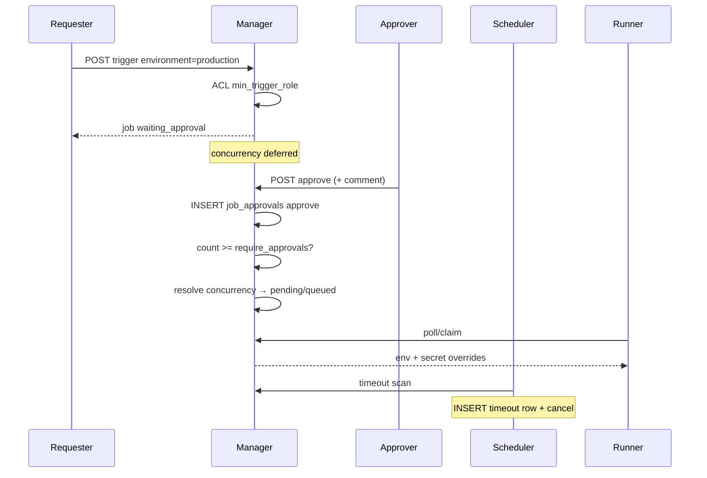

# Environment Approval Gates

Related: [Environments](../environments/) · [Users, Teams & RBAC](../rbac/) · [Admin Audit Logs](../admin-audit-logs/)

## Why this exists

Environments can overlay **Variable and Secret defaults** for a run. Without a
gate, anyone who can Trigger a pipeline could select `production` and receive
prod overrides at claim time.

Approval gates separate three concerns:

| Concern | Who |
|---------|-----|
| **Configure** overrides / protection policy | Platform admin |
| **Request** a deploy into a protected env | Team role ≥ `min_trigger_role` |
| **Authorize** the run | Distinct approvers ≥ `min_approve_role` |

## Design principles

1. **Opt-in protection** — `protection_enabled = false` keeps legacy behavior
   (Trigger → pending/queued immediately).
2. **Separation of duties** — default `forbid_self_approve = true` so the
   requester cannot single-handedly release their own job.
3. **Policy frozen at trigger** — `job.snapshot.protection` is a copy of the
   Environment rules at request time; mid-flight edits do not rewrite an
   in-flight gate.
4. **Approval before concurrency** — `waiting_approval` does **not** consume a
   concurrency slot. Concurrency (`pending` / `queued` / 409) runs **after**
   the approval threshold is met.
5. **Append-only event log** — every human/system decision is a row in
   `job_approvals` (never updated). Platform `audit_logs` is a second,
   operator-facing trail.
6. **No secret leakage** — approval comments and records never contain secret
   values; claim still decrypts overrides only after promote to `pending`.
7. **Automated triggers stay out** — webhook / git / cron cannot target a
   protected Environment (403). Manual UI / user API token only.

## State machine

```text
                 protection off
  Trigger ──────────────────────────► pending | queued ──► running ──► terminal

                 protection on + ACL ok
  Trigger ──► waiting_approval ──┬── approve×N ──► pending | queued ──► …
                                 ├── reject ──────► cancelled
                                 ├── cancel ──────► cancelled
                                 └── timeout ─────► cancelled
```

| Status | Claimable? | Meaning |
|--------|------------|---------|
| `waiting_approval` | No | Waiting for human approvals |
| `pending` / `queued` | Yes / later | Normal execution path |
| `cancelled` | No | Rejected, timed out, or operator cancel |

Reject / timeout / cancel while waiting all land on **`cancelled`**. The
**reason** lives in `snapshot.approval.outcome` and in `job_approvals.action`
(`reject` | `timeout` | `cancel`), not a separate job status.

## Protection fields (on `environments`)

| Field | Default | Meaning |
|-------|---------|---------|
| `protection_enabled` | `false` | Master switch |
| `min_trigger_role` | `developer` | Who may request (`owner` \| `maintainer` \| `developer`) |
| `min_approve_role` | `maintainer` | Who may approve / reject |
| `require_approvals` | `1` | Distinct `approve` rows required before promote |
| `forbid_self_approve` | `true` | Trigger user cannot approve/reject own job (platform admin exempt) |
| `approval_timeout_seconds` | `86400` | Scheduler cancels wait after this age |

Platform admin always passes **role** checks (`min_trigger_role` /
`min_approve_role`) and may approve/reject even when they triggered the job.
Viewer never triggers. Non-admin trigger users remain blocked by
`forbid_self_approve`.

## Append-only approval records (`job_approvals`)

Every decision creates one row. Rows are **never updated or deleted** except via
job cascade delete.

```sql
CREATE TABLE job_approvals (
    id TEXT PRIMARY KEY,
    job_id TEXT NOT NULL REFERENCES jobs(id) ON DELETE CASCADE,
    user_id TEXT NOT NULL,          -- actor id, or 'system' for timeout
    username TEXT NOT NULL DEFAULT '', -- durable display name
    action TEXT NOT NULL,           -- approve | reject | cancel | timeout
    comment TEXT NOT NULL DEFAULT '',
    created_at TEXT NOT NULL DEFAULT (datetime('now')),
    UNIQUE(job_id, user_id, action)
);
```

| `action` | When | `user_id` |
|----------|------|-----------|
| `approve` | `POST /jobs/{id}/approve` | Approver |
| `reject` | `POST /jobs/{id}/reject` | Rejector |
| `cancel` | Cancel while `waiting_approval` | Operator |
| `timeout` | Scheduler expiry | `system` |

`UNIQUE(job_id, user_id, action)` prevents double-approve by the same user.
Different actions by the same user (e.g. approve then — not applicable once
promoted) are constrained by job status checks.

### Dual recording

| Store | Purpose |
|-------|---------|
| `job_approvals` | Per-job chronological trail for Job Detail |
| `audit_logs` (`job.approve` / `job.reject` / …) | Platform admin audit (redacted) |
| `jobs.snapshot.approval` | Summary `{ required, received, outcome? }` for badges |

`GET /jobs/{id}` returns `approvals: [...]` joined from `job_approvals`
(ordered by `created_at`).

## Trigger & promote flow



## API

| Method | Path | Notes |
|--------|------|-------|
| POST | `/pipelines/{id}/trigger` | Protected → `status: waiting_approval`, `approval_required: true` |
| POST | `/jobs/{id}/approve` | Body `{ comment? }`; returns received/required/status |
| POST | `/jobs/{id}/reject` | Body `{ comment? }` → cancelled |
| POST | `/jobs/{id}/cancel` | Also records `cancel` if was waiting |
| GET | `/jobs/{id}` | Includes `approvals[]` + `snapshot.approval` |

## Concurrent decisions & race semantics

`approve`, `reject` and `cancel` serialize through a `BEGIN IMMEDIATE`
transaction and re-check the job status **inside** it; every state write is
conditional (`WHERE status = 'waiting_approval'`, or the non-terminal set for
cancel). When decisions race, exactly one wins — every loser gets
`409 Conflict` with no side effects: no `job_approvals` row, no snapshot
rewrite, no notify/broadcast.

| Race | Outcome |
|------|---------|
| `approve` vs `reject` | First commit wins (promote vs `cancelled` + outcome `rejected`). The loser returns 409 `job is no longer waiting for approval` and appends nothing. |
| `approve` twice, same user | Second insert violates `UNIQUE(job_id, user_id, action)` → 409 `you have already approved this job`. |
| `approve` twice, threshold met by the first | First promotes to `pending`/`queued`; the second fails the in-transaction status re-check → 409, no extra row. |
| `cancel` wins, then late `approve`/`reject` | Outcome stays `cancelled`; the late decision gets 409 and appends nothing. |
| `approve` reaches threshold first, then `cancel` | The job was promoted, so operator cancel legitimately cancels a `pending` job. `snapshot.approval.outcome` stays `approved`; no `cancel` trail row is written (cancel rows exist only while `waiting_approval`). |

Additional guarantees:

- **Snapshot re-read** — `reject` and `cancel` re-read `jobs.snapshot` inside
  the transaction, so an approve that committed just before them keeps its
  `approval.received` count. This matters when `require_approvals ≥ 2`: a
  mid-flight approve below the threshold is not clobbered by a concurrent
  reject.
- **Approve recorded, concurrency blocked** — if the threshold is met but the
  concurrency resolver returns Conflict (queue full / `discard-new`), the
  approval row is kept and the job stays `waiting_approval`; the API returns
  409 with the concurrency reason.
- **System actors** — approval timeout records `timeout` as
  `user_id='system'`; environment `cancel_in_progress` auto-cancel of a
  waiting job records `cancel` as `user_id='system:environment'`; manual
  operator cancel records the operator identity.

These semantics are locked by regression tests in
`crates/manager/src/api/tests/approval_race_tests.rs` and
`cancel_in_progress_tests.rs`.

## UI

- **Environments** — Protection card (platform admin)
- **Trigger** — Protected env labeled; amber hint with min trigger role
- **Job Detail** — Waiting banner, Approve/Reject (+ comment), **Approval history** in a right sidebar (append-only trail; no pagination — few events per job)

## Out of scope (documented deferrals)

- Feishu / `notify:` events for `approval_needed` (Dashboard is v1 signal)
- Named reviewers / groups (role thresholds only)
- Multi-stage approval chains
- Automated request + human approve (`allow_automated_request`)

## Related schema notes

See [Database Schema](/docs/02-development/database-schema/) for column tables.
`jobs.trigger_user_id` is set for manual triggers so self-approve checks do not
depend on parsing `trigger_by` usernames.
